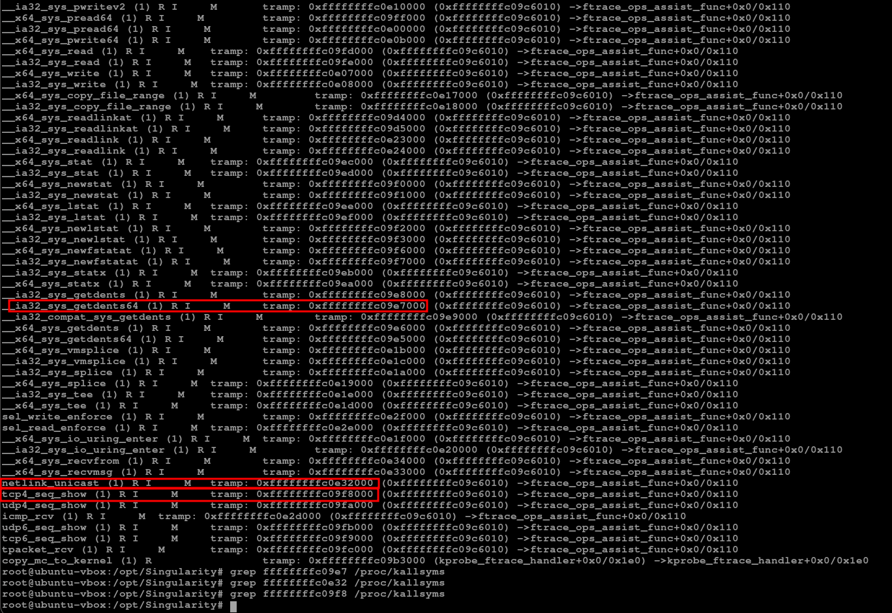

---

This article explores two sides of ftrace-based Linux rootkits:

1. Hunting Ftrace-Based Linux Rootkits Using Only cat and grep

2. Hiding ftrace ops: A New Linux Rootkit Technique

---

# 1. Hunting Ftrace-Based Linux Rootkits Using Only cat and grep
The command:
```
cat /sys/kernel/tracing/enabled_functions
```
displays the list of kernel functions currently being traced by ftrace and the address, along with additional information about their registered callbacks. This information can include the callback count, ftrace flags, and the address of an associated trampoline.

One way to investigate an unfamiliar ftrace trampoline is to search for its address in /proc/kallsyms.

The idea is to correlate the trampoline address exposed by enabled_functions with kernel symbols and identify whether the memory page containing that trampoline belongs to a known kernel component, such as a loaded kernel module or a BPF program.

For example, suppose enabled_functions contains:
```
cat /sys/kernel/tracing/enabled_functions
netlink_unicast (1) R I     M   tramp: 0xffffffffc0e32000 (0xffffffffc09c6010) ->ftrace_ops_as
sist_func+0x0/0x110
```

If the command:

```
grep ffffffffc0e32000 /proc/kallsyms
```

returns no results, the trampoline deserves further investigation. This can be an indication of a hidden rootkit.

What can we learn from this technique?
1. Rootkit capabilities and functionality: The functions being traced provide clues about what the rootkit is capable of doing. For example:
  - __x64_sys_getdents64: potentially manipulating directory listings and hiding files.
  - tcp4_seq_show: potentially hiding network connections.
  - commit_creds: potentially manipulating credentials and privilege escalation.
2. Rootkit code location: the trampoline address provides a starting point for locating the executable memory containing the rootkit's tracing code.

The following example illustrates what the output looks like on a Linux system infected with the Singularity rootkit, showing suspicious ftrace operations and their associated trampoline addresses:

|  |
|:--:|
| *singularity rootkit traces* |


# 2. Hiding ftrace ops: A New Linux Rootkit Technique
## 2.1. Understanding ftrace's Internal Data Structures
To understand the hiding technique, we first need to understand how ftrace keeps track of the kernel functions available for tracing.

The relevant data structures are ftrace_pages_start, struct ftrace_page, and struct dyn_ftrace, all implemented in kernel/trace/ftrace.c.
### 2.1.1. ftrace_pages_start
ftrace_pages_start is a global pointer that references the first element of a linked list of struct ftrace_page structures.
```
static struct ftrace_page *ftrace_pages_start;
```

This linked list maintains the records used by dynamic ftrace to keep track of instrumentable kernel functions.

When ftrace initializes, it allocates the necessary pages and assigns the first page to both ftrace_pages_start and ftrace_pages.

Additional pages are linked as needed.

Consequently, traversing this list allows us to enumerate the ftrace record groups maintained by the kernel.

### 2.1.2 struct ftrace_page
The structure represents a group of dynamically allocated ftrace records:
```
struct ftrace_page {
	struct ftrace_page	*next;
	struct dyn_ftrace	*records;
	int			index;
	int			order;
};
```
Each field has a specific purpose:
- next: Pointer to the next ftrace_page in the linked list.
- records: Pointer to the array of dyn_ftrace records stored in this allocation.
- index: Number of valid records currently stored in the array.
- order: Allocation order of the backing pages (2^order pages).

### 2.1.3 struct dyn_ftrace
This is the structure that actually represents an individual function tracked by dynamic ftrace.

Its definition varies across kernel versions, but conceptually it contains information such as:
```
struct dyn_ftrace {
	unsigned long		ip; /* address of mcount call-site */
	unsigned long		flags;
	struct dyn_arch_ftrace	arch;
};
```
The most important fields for our purposes are:
- ip: Instruction address of the kernel function associated with this record.
- flags: Internal state associated with the record, such as whether the function is enabled for tracing or other architecture-specific states.

## 2.2. Hiding Ftrace Operations
The technique is surprisingly simple: it consists of clearing bit 0 of the flags field in the corresponding struct dyn_ftrace record.

This bit represents FTRACE_OPS_FL_ENABLED, which indicates whether the associated function is enabled for ftrace tracing.

By clearing this bit, the kernel no longer considers the corresponding ftrace record enabled. As a result, the function will no longer appear in:
```
/sys/kernel/tracing/enabled_functions
```

The important aspect of this technique is that the ftrace operation can remain registered and its callback can remain present, while the corresponding function disappears from the userspace-visible list of enabled functions.

The following code demonstrates how to hide and restore an ftrace-traced function by modifying the corresponding dyn_ftrace record flags. The target_func_addr variable represents the address of the kernel function being traced. This address can be resolved using kallsyms lookup.

### 2.2.1 hide
```
page = ftrace_pages_start;
while (page) {
    for (i = 0; i < page->index; i++) {
        rec = &page->records[i];
        if (rec->ip == target_func_addr)
            rec->flags &= ~0x80000000;
    }
    page = page->next;
}
```

### 2.2.2 show
```
page = ftrace_pages_start;
while (page) {
    for (i = 0; i < page->index; i++) {
        rec = &page->records[i];
        if (rec->ip == target_func_addr)
            rec->flags |= 0x80000000;
    }
    page = page->next;
}
```

